# Lap gates and the mission 6 lap glitch

**Created** 2026-10-05 17:08 +0200 · **Modified** 2026-10-05 22:07 +0200

How the PC build of Mafia counts racing laps, why the mission 6 race ("Fair Play", circuit 0,
scene `MISE06-AUTODROM`) can be finished by driving circles on the grass next to checkpoint 9,
and how the PS2 build compares (§8).

All coordinates are **world X / world Z** (the ground plane; Y is height and the lap code ignores
it). The figures are generated from the shipped `missions/MISE06-AUTODROM/check.bin` and an exact
re-implementation of the PC gate test (§10).

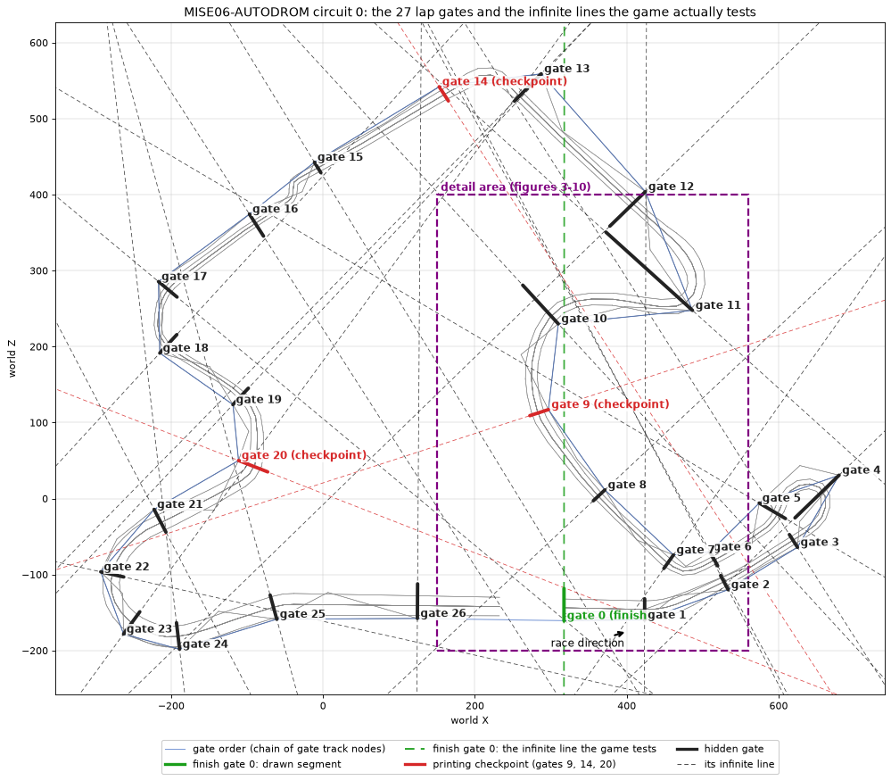

**Figure 1.** The whole circuit. Thick segments are the gates as two map points; the dashed lines
are what the game actually tests: the **infinite** line through those two points. The finish line
(green, gate 0, `x ≈ 317.3`) runs straight up the map past checkpoint 9 and gate 10. Every other
gate line continues across the map the same way.

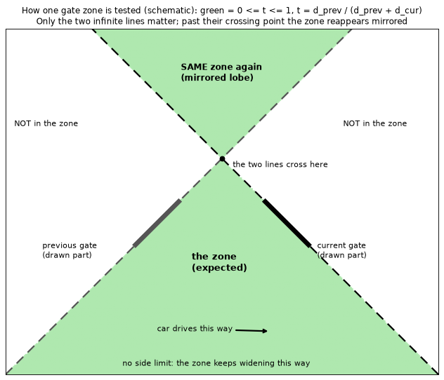

**Figure 2.** Schematic of one gate zone. The car belongs to gate *G* when it lies between the
infinite line of the previous gate and the infinite line of *G*. The zone has no side limit, and
beyond the point where the two lines cross it appears again, mirrored.

---

## 1. Summary

* A racer remembers one **current gate**. Once per **1000 ms** the game checks the car's position
  against the zones of the current gate, the **next** gate and the **previous** gate, in that
  order, and moves the current gate accordingly. Passing forward out of the finish gate's zone adds
  a lap; passing backward into it removes one.
* If the car is in none of those three zones the racer is **lost**: the game scans gates 0..26 and
  takes the **first** one whose zone contains the car. No lap is added or removed.
* On circuit 0 the finish zone (between gate 26's line `x ≈ 124.3` and gate 0's line `x ≈ 317.3`)
  is a 193 m wide strip across the **whole** map, including the hill next to checkpoint 9. A racer
  that gets lost there is given the **finish gate**, and crossing `x = 317.3` to the right then
  counts as a completed lap, hundreds of metres from the real finish line.
* Two PC-only behaviours let a racer get lost there on purpose and do it repeatedly: the
  neighbour test always checks **forward before backward**, so a wrong-way move into a place where
  two zones overlap is read as progress, and the coarse 1000 ms check.
* The PS2 build does not allow the trick; §8 compares the two builds.

---

## 2. The gates of circuit 0

### 2a. How the game builds them

`circuit_load_gates_from_scene` walks the mission's navigation web (`check.bin`, 860 nodes) from
the node with ID `0x27c` (array index 508). Each node of that walk is a **track node**; among its
neighbours the one with exactly **one** connection is the gate's **outer marker**, the next node
of the walk is the one with more connections, and neighbours whose category word has bit `0x8` are
race-camera nodes (26 of them) collected into the circuit's camera list. One gate is created per
track node and the gates are closed into a ring (`next` / `previous` pointers).

A gate **prints the checkpoint time** when the first connection of its outer marker carries flag
bit `0x80` (the connection's ONE-WAY bit, `structs/web_path.md` §2). Only gates **9, 14 and 20**
have it; the other 24 gates are invisible.

### 2b. The gate record (`C_racing_gate`, 0x2c bytes, PC offsets)

| Offset | Field | Notes |
|---|---|---|
| +0x00 | `C_web_node*` track node | defines the gate line with +0x04 |
| +0x04 | `C_web_node*` outer marker | the node with one connection |
| +0x08 | `S_vector` midpoint | midpoint of the two nodes |
| +0x14 | `C_racing_gate*` next gate | ring link |
| +0x18 | `C_racing_gate*` previous gate | ring link |
| +0x1c | `uint` gate number | index in the circuit's gate vector |
| +0x20 | `bool` prints checkpoint time | outer marker's connection bit `0x80` |
| +0x24 | `uint` stored split time | cleared on **all** gates at every forward crossing, so the "compare with stored split" branch never runs |
| +0x28 | `float` distance to the next gate's midpoint | summed by `racing_get_distance_by_gates` |

The circuit keeps the gate vector at `C_circuit+0x44` (begin) / `+0x48` (end).

### 2c. The 27 gates

Track node and outer marker are array indices into `check.bin`'s node array.

| Gate | Track node | X, Z | Outer marker | X, Z | Length m | Prints time |
|---|---|---|---|---|---|---|
| 0 | 508 | 317.31, -160.70 | 509 | 317.33, -118.40 | 42.30 | finish |
| 1 | 591 | 423.49, -159.79 | 597 | 423.58, -131.95 | 27.84 | - |
| 2 | 747 | 533.52, -119.92 | 740 | 523.63, -101.29 | 21.09 | - |
| 3 | 809 | 624.83, -64.15 | 801 | 614.19, -47.40 | 19.84 | - |
| 4 | 859 | 679.65, 30.75 | 807 | 621.54, -25.39 | 80.80 | - |
| 5 | 773 | 574.47, -5.92 | 798 | 609.02, -26.31 | 40.12 | - |
| 6 | 738 | 509.74, -70.19 | 739 | 519.71, -88.48 | 20.84 | - |
| 7 | 657 | 461.47, -74.19 | 632 | 448.88, -91.98 | 21.79 | - |
| 8 | 550 | 371.19, 11.39 | 541 | 356.00, -2.85 | 20.82 | - |
| 9 | 483 | 296.80, 117.08 | 434 | 272.36, 109.14 | 25.70 | yes |
| 10 | 501 | 309.81, 229.96 | 422 | 263.00, 280.82 | 69.12 | - |
| 11 | 708 | 486.51, 247.68 | 551 | 372.48, 350.67 | 153.65 | - |
| 12 | 599 | 424.46, 403.88 | 552 | 377.73, 358.54 | 65.12 | - |
| 13 | 474 | 287.29, 559.02 | 418 | 252.03, 523.04 | 50.38 | - |
| 14 | 372 | 152.90, 542.04 | 379 | 165.06, 523.28 | 22.35 | yes |
| 15 | 357 | -11.34, 442.63 | 359 | -2.90, 428.80 | 16.21 | - |
| 16 | 249 | -96.97, 374.30 | 287 | -78.45, 345.40 | 34.32 | - |
| 17 | 104 | -216.74, 285.55 | 163 | -192.34, 265.23 | 31.76 | - |
| 18 | 109 | -215.02, 191.45 | 162 | -192.67, 215.70 | 32.98 | - |
| 19 | 217 | -118.67, 123.65 | 247 | -98.41, 145.22 | 29.59 | - |
| 20 | 225 | -111.31, 50.11 | 290 | -72.93, 35.13 | 41.20 | yes |
| 21 | 86 | -222.54, -14.29 | 130 | -206.94, -44.16 | 33.69 | - |
| 22 | 0 | -292.79, -96.42 | 44 | -262.54, -103.15 | 30.99 | - |
| 23 | 43 | -262.77, -178.31 | 69 | -241.39, -149.05 | 36.24 | - |
| 24 | 166 | -189.01, -198.29 | 157 | -193.05, -163.41 | 35.11 | - |
| 25 | 298 | -60.98, -158.74 | 291 | -69.71, -127.05 | 32.87 | - |
| 26 | 370 | 124.21, -157.77 | 371 | 124.51, -112.25 | 45.53 | - |

The race runs gate 0 → 1 → 2 … → 26 → 0 (the start straight runs toward `+X`).

---

## 3. The gate test

### 3a. `racing_test_gate_crossing` — is the car in a gate's zone?

Read from the disassembly (the decompiler output of this function is incomplete). For gate *G*
with previous gate *P* and the probe point *p* (X and Z only):

```
d_prev = signed distance of p from P's line, measured from P's outer marker,
         normal (dz, -dx) of P's direction (outer marker - track node)
d_cur  = signed distance of p from G's line, measured from G's track node,
         normal (-dz, dx) of G's direction
t      = d_prev / (d_prev + d_cur)
in the zone  <=>  0.0 <= t <= 1.0      (t is written to C_opponent+0x4c)
```

* The lines are **infinite**: nothing bounds the zone sideways, and the drawn length of a gate has
  no effect.
* `0 <= t <= 1` holds both when `d_prev >= 0` and `d_cur >= 0` (between the lines) and when both
  are `<= 0`. When the two lines are not parallel, the second case is the mirrored lobe beyond
  their crossing point (Figure 2). Zones of different gates therefore **overlap** widely: a point
  on the track between gates 8 and 9 is also inside the zones of gates 1, 4, 14, 15, 18, 20 and 23.
* The probe point is the car's AI probe point (`car_get_ai_probe_point(1)`), which the call also
  caches at `C_car+0x1fd8` (X), `+0x1fdc` (Y), `+0x1fe0` (Z).

Checked against the data: every point on the track between gate *i−1* and gate *i* lies in
gate *i*'s zone, for all 27 gates.

### 3b. `racing_test_gate` — the three-zone check

Tests, in this fixed order: the **current** gate's zone → returns 0; the **next** gate's zone →
returns +1; the **previous** gate's zone → returns −1; none → returns −100 (also returned when the
racer has no car).

### 3c. `racing_test_all_gates` — putting a lost racer back

Scans gates 0, 1, 2 … 26 and returns the first whose zone contains the probe point. Because gate
0 is tested first, **any** lost racer inside the finish strip gets the finish gate.

### 3d. `racing_do_gates` — what each result does (single player)

| Result | Effect |
|---|---|
| 0 | nothing |
| +1 | the current gate becomes the next gate; leaving gate 0 can add a **lap** (below) |
| −1 | the current gate becomes the previous gate; if that is gate 0: **lap −1**, start-crossing flag and timed-lap flag (`+0x46`) cleared |
| −100 | re-seat from `racing_test_all_gates`; **no lap change, no print** |

Result +1 in detail, before the current gate moves on:

* Current gate 0 and the start-crossing flag (`C_opponent+0x45`) clear: **lap +1**, HUD lap
  text, best-lap test, new lap start time; at the race's lap count, `opponent_finish`.
* Current gate prints, and the racer is the player and has not finished: "> checkpoint <" with
  the time since the lap started.
* When the new current gate is gate 2, the start-crossing flag is cleared.

`racing_init_racers` starts every racer with the current gate = gate 0, lap counter 0 and the
start-crossing flag = 1, so the first finish crossing (leaving the grid) does not count. The HUD
shows the counter + 1. Mission 6 runs **5** laps (`racing_mission6_init 5, …` → `C_racing+0x27c`);
when the counter reaches 5, `opponent_finish` records the racer's place in the standings, which
sort a higher lap counter first.

In network sessions the same branches post event messages instead of changing the lap directly
(+1: types `0x3f` / `0x3e`; −1 over the finish: `0x41` / `0x40`, for a human / an AI racer).

### 3e. How often it runs

`racing_tick` (race phase 1) adds the frame time to `C_racing+0x29c`; only when it exceeds
`C_racing+0x2a0` (set to **1000 ms** after every pass) does it reset the accumulator to 0 and call
`racing_do_gates` for every racer. **Gate positions are therefore sampled about once per second**;
in between, the car can move any distance.

---

## 4. The geometry of circuit 0 near checkpoint 9

| Lines | Cross at (X, Z) | Meaning |
|---|---|---|
| gate 0 × gate 26 | 335.5, 32248.1 | far off the map: the finish zone is a strip |
| gate 0 × gate 1 | 293.6, -42406.9 | far off the map: gate 1's zone is a strip `317.3 < x < 423.5` |
| gate 0 × gate 9 | 317.5, 123.8 | the finish line's continuation passes right by checkpoint 9 |
| gate 0 × gate 10 | 317.5, 221.6 | 8 m from gate 10's track node |
| gate 0 × gate 2 | **317.6, 286.8** | where the continuation seems to "end" for the loop (§6) |
| gate 1 × gate 2 | 424.2, 85.9 | gives gate 2's zone its mirrored lobe on the hill |
| gate 9 × gate 10 | 386.8, 146.3 | inside the checkpoint bend's infield |
| gate 10 × gate 12 | **279.4, 263.0** | start of the setup wedge (§5) |

The racing line itself crosses the finish line's continuation twice in normal driving: leftward
just before checkpoint 9 and rightward just after gate 10. Neither matters in a normal lap,
because the current gate there is 9 or 11 and the finish gate is not tested.

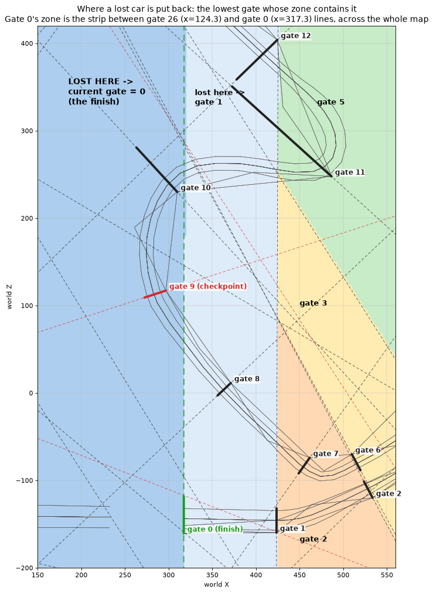

**Figure 3.** The gate a lost racer is given. Everything left of the finish line's continuation
(down to gate 26's line at `x ≈ 124.3`) gives **gate 0**; the strip up to `x ≈ 423.5` gives gate 1.

Reference maps of what a check does with the current gate at 9 or 10, i.e. before and right after
checkpoint 9 prints. On the track both follow the car correctly; the setup needs gate 11 (§5).

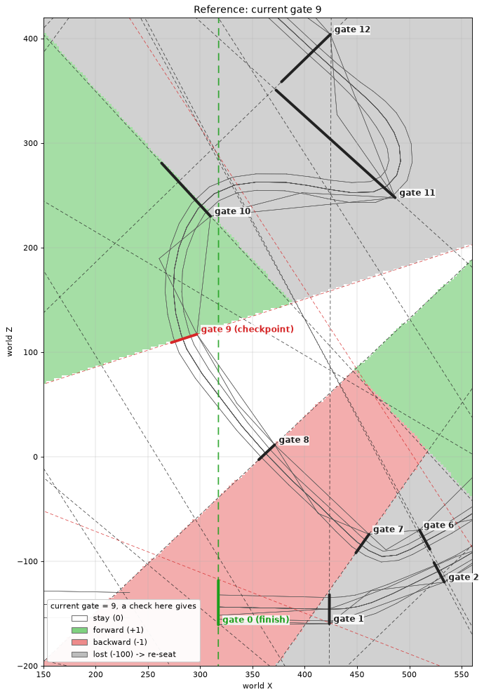

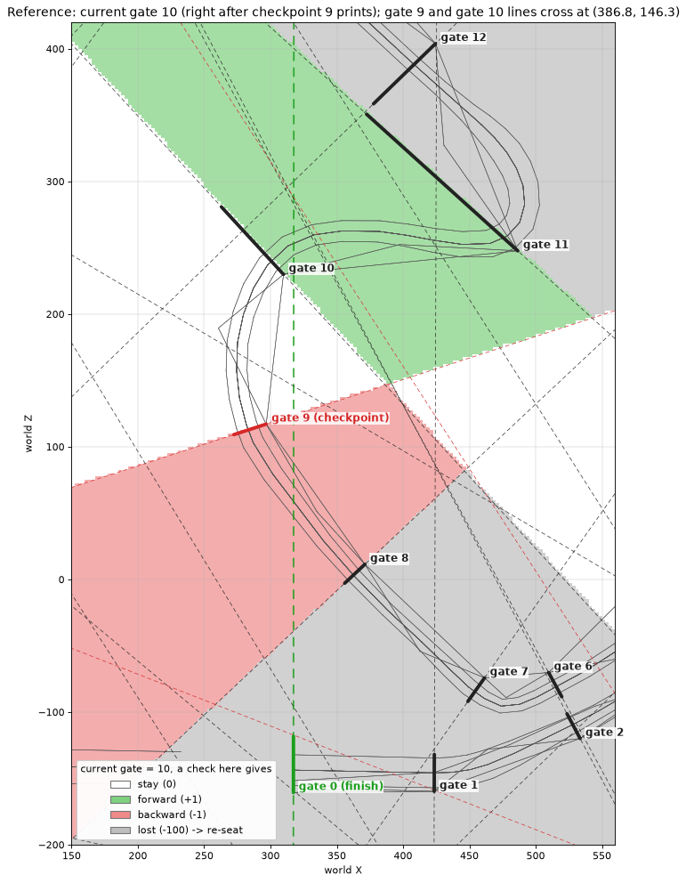

---

## 5. The setup: making the finish gate current on the hill

Reconstructed sequence (simulated, 1000 ms checks, about 20 m/s):

```
(370, 14)   gate 8 -> 9
(298, 130)  checkpoint 9 prints, gate 9 -> 10
(329, 232)  gate 10 -> 11      past gate 10's line (the hidden gate after the checkpoint)
(273, 258)  gate 11 -> 12      wrong way onto the hill, read as FORWARD
(265, 226)  lost -> gate 0     the finish gate is now current
(330, 232)  lap +1             crossing the finish line's continuation after gate 10
```

1. **"Drive a bit forward from the checkpoint first."** The car must get past **gate 10's line**
   so that the current gate becomes 11. Turning back earlier is followed correctly as backward
   movement, and checkpoint 9 prints again on the next pass.
2. **"Turn back the wrong way."** On the hill outside the bend, beyond the point
   **(279.4, 263.0)** where gate 10's line meets gate 12's line, gate 10's zone (backward) and gate
   12's zone (forward) overlap. With current gate 11 the PC tests forward first, so a check there
   moves the racer to gate 12 (Figure 4, green wedge).
3. **The next check** is in none of gate 12's, 13's or 11's zones (Figure 5, grey): the racer is
   lost and, being left of `x = 317.3`, gets gate 0.
4. **"Nothing printed the second time."** With gate 0 current, the car is inside the finish strip
   the whole way back through checkpoint 9; gate 9 is not even tested.
5. **"Lap added at the continuation."** Crossing `x = 317.3` rightward after gate 10 moves the
   car from gate 0's zone into gate 1's zone: +1 from the finish gate, a lap.

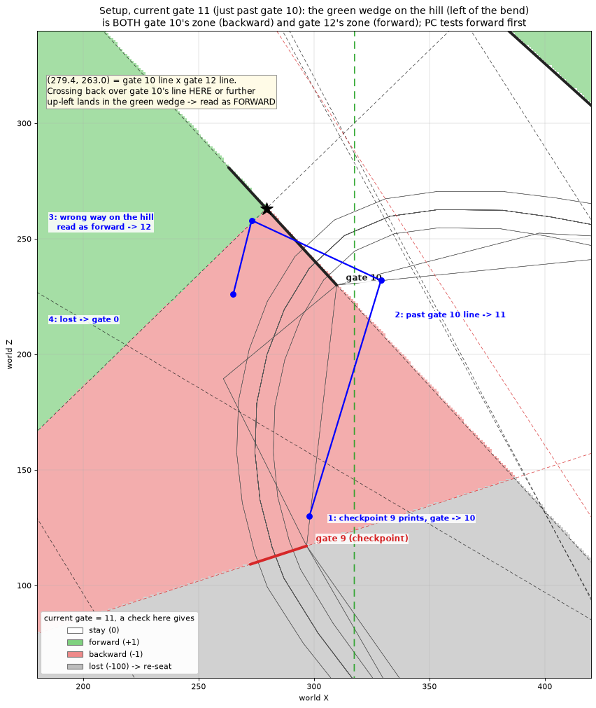

**Figure 4.** Current gate 11. Green = forward (+1), red = backward (−1), grey = lost. The green
wedge on the hill starts at (279.4, 263.0) and widens up-left between gate 10's line and gate 12's
line. Blue: the reconstructed sequence above.

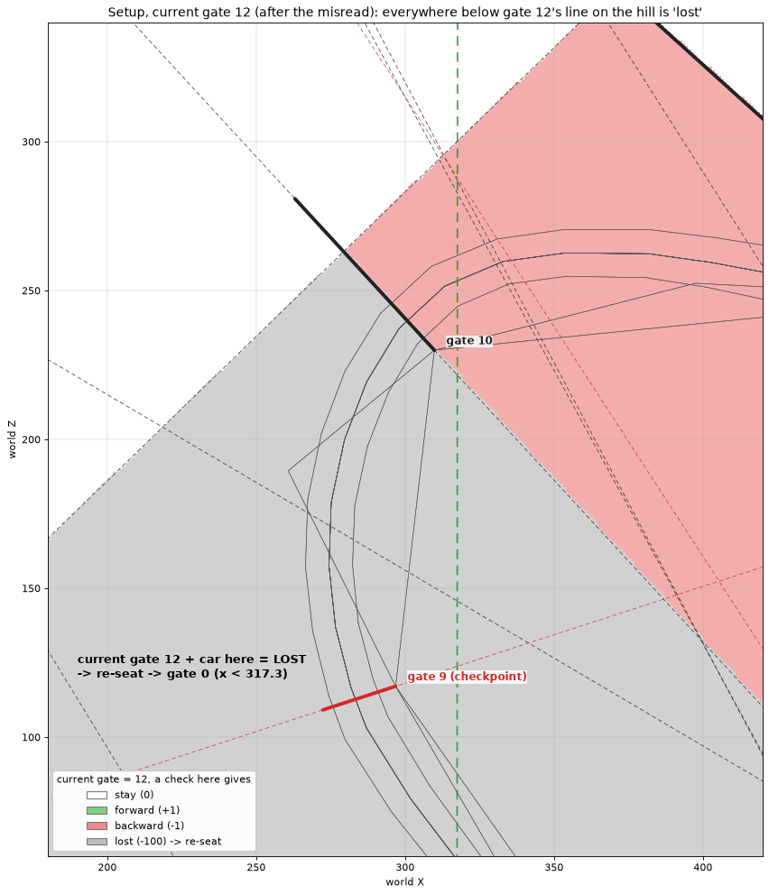

**Figure 5.** Current gate 12, after the misread. Everything below gate 12's line on the hill is
"lost", which puts the racer on gate 0.

**The failure "not going back far enough".** Simulated with the car turning 20 m past gate 10,
crossing back over gate 10's line at a fraction *f* of the way from its track node (0) to its outer
marker (1), then down the hill and back onto the track before checkpoint 9; 20 sample phases each:

| Cross back over gate 10's line at | 4 m/s | 6 m/s | 8 m/s | 12 m/s |
|---|---|---|---|---|
| f = 0.3 … 0.7, (296, 245) … (277, 266) | 0/20 | 0/20 | 0/20 | 0/20 |
| f = 0.8, (272, 271) | 20/20 | 20/20 | 15/20 | 10/20 |
| f = 1.0, (263, 281) — the outer marker | 20/20 | 20/20 | 20/20 | 20/20 |
| f = 1.3, (249, 296) | 20/20 | 20/20 | 20/20 | 20/20 |

Crossing back closer to the track than about (279, 263) is read as plain backward movement
(11 → 10) and the setup does nothing. At or beyond the outer marker it works every time.

Other ways to make gate 0 current on the hill, all consistent with the same rule:

* **Teleporting** onto the hill left of `x = 317.3`: the first check finds the car outside its
  current gate's neighbours → lost → gate 0.
* **Driving there from the grid without passing gate 1**: the current gate never leaves gate 0,
  because the start grid and the hill are both in the finish strip. The start-crossing flag is
  still set, so the first loop counts nothing, but its wrong-way crossing moves the racer to gate 2,
  which clears the flag; every later loop counts.

---

## 6. The loop: one lap per circle

After a counted lap the current gate is 1 and the car is in the strip `317.3 < x < 423.5`.

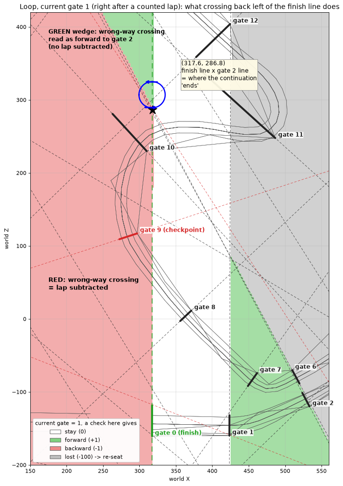

**Figure 6.** Current gate 1. A wrong-way crossing of the finish line's continuation closer to the
start than **z ≈ 287** lands in gate 0's zone: **lap −1**. Further out it lands in the mirrored
lobe of gate 2's zone (the green wedge between the continuation and gate 2's line), and with
forward tested first the racer moves to **gate 2 with no lap change**.

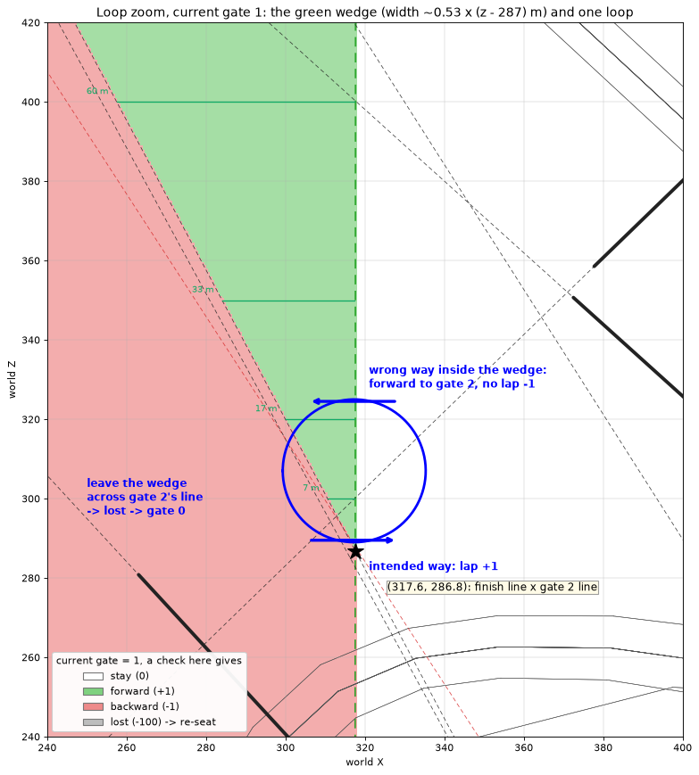

**Figure 6b.** The wedge in detail. Its width is about `0.53 × (z − 286.8)` m: 7 m at z = 300,
17 m at z = 320, 33 m at z = 350, 60 m at z = 400. Blue: one loop.

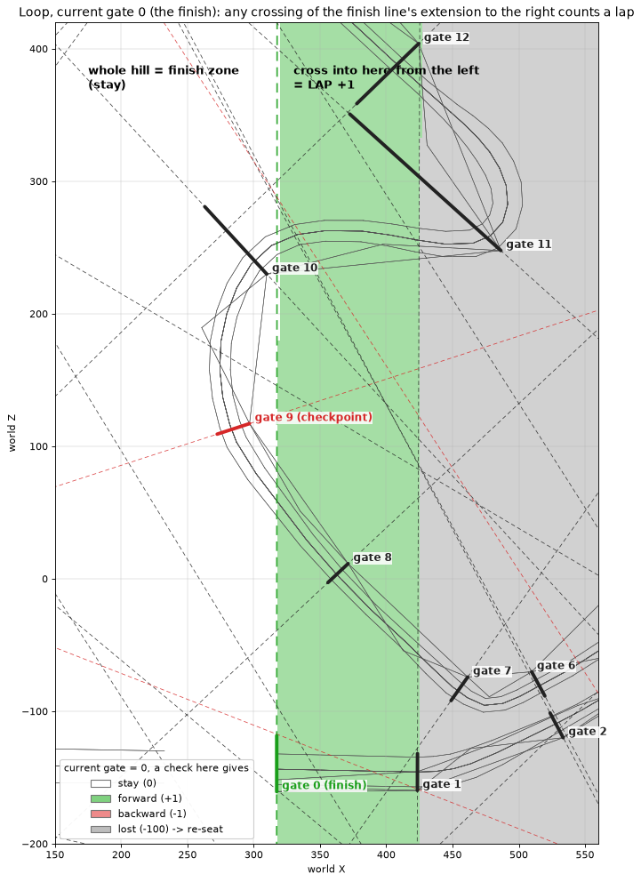

**Figure 7.** Current gate 0: the whole hill is "stay"; crossing the continuation rightward into
the gate 1 strip is +1 from the finish gate, **lap +1**.

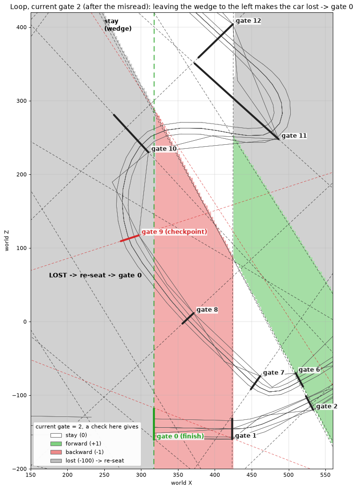

**Figure 8.** Current gate 2: leaving the wedge to the left across gate 2's line makes the racer
lost, and the hill gives gate 0 again.

One loop therefore runs: cross the continuation rightward (gate 0 → 1, **lap +1**), come back
across it leftward **inside the wedge** (gate 1 → 2), continue left **out of the wedge** across
gate 2's line (lost → gate 0), and repeat. Three conditions:

1. The wrong-way crossing must be beyond z ≈ 287, with a margin: the first check after the
   crossing lands up to *speed × 1 s* past the line, and must still be inside the wedge.
2. The leftward part must leave the wedge across gate 2's line; a loop that stays inside it keeps
   gate 2 and never gets gate 0 back.
3. The rightward part must be checked while still left of gate 1's line (`x ≈ 423.5`); beyond it
   the racer is lost into gates 3 or 5 and the lap is not counted.

Simulated with circles of radius 18 m centred on the continuation, 5 circles, 20 sample phases:

| Wrong-way crossing at z | 4 m/s | 6 m/s | 8 m/s | 12 m/s |
|---|---|---|---|---|
| 280 | 0 | 0 | 0 | 0 |
| 288 | 1-2 | 0-1 | 0-1 | 0-1 |
| 295 | 5 | 3-5 | 1-4 | 1-3 |
| 300 | 5 | 5 | 4-5 | 2-3 |
| 310 | 5 | 5 | 5 | 4-5 |
| 325 | 5 | 5 | 5 | 5 |
| 350 | 1 | 1 | 1 | 1 |

At z = 350 the 18 m circle never leaves the 33 m wide wedge (condition 2), so only the first
crossing counts.

---

## 7. Speed and the once-per-second check

Between two checks the car moves *speed × 1 s*. At 1st-gear speeds (4-8 m/s) the checks fall a
few metres apart, every zone along the path is sampled, and the outcome depends only on the path:
done on the right path the setup and the loop work every time, which matches the in-game
experience. At higher speed a check can jump over the narrow parts (the wedge near z = 287, the
start of the setup wedge near (279, 263)), and the result starts depending on where the checks
happen to fall.

---

## 8. PC vs PS2

The PS2 copy of `MISE06-AUTODROM/check.bin` has 409 nodes instead of 860, but the gate walk
produces **the same 27 gates with byte-identical coordinates and the same three printing
checkpoints**. PS2 `InternTestGate` is the same infinite-line formula as the PC (same normals,
same base points, same `0 <= t <= 1`). The PS2 gate record keeps the nodes at `+0x10` / `+0x14`,
`next` at `+0x18`, `previous` at `+0x1c`, the gate number at `+0x20` and the print flag at
`+0x2c`.

| | PC | PS2 |
|---|---|---|
| neighbour test order (`TestGate`) | current, next, previous — always | current, then **previous first if the last stored `t` < 0.5**, otherwise next first |
| gate check period | 1000 ms | 500 ms |
| backward over the finish | lap −1, start-crossing flag cleared | lap kept, start-crossing flag **set** (the next finish crossing does not count) |
| crossing the halfway gate | - | sets a flag that only rebuilds the AI driver's path |

Effect of each difference on the loop, measured by swapping it alone into the PC logic (5 circles
with the wrong-way crossing at z = 323, four speeds, ten sample phases):

| Neighbour order | Backward over finish | Period | Laps gained |
|---|---|---|---|
| PC | PC | 1000 | 3-5 |
| PC | PC | 500 | 5 |
| PC | PS2 | 1000 / 500 | 3-5 / 5 |
| PS2 | PC | 1000 / 500 | 0 |
| PS2 | PS2 | 1000 / 500 | 1 (the first crossing only) |

**The neighbour order alone decides it.** Right after a lap the car is close to the finish line,
its stored `t` is small, and PS2 tests the previous zone first: the wrong-way crossing is seen as
backward over the finish and the next crossing is blocked. The same ordering catches the setup
step: in 240 runs of the §5 setup paths at 4-12 m/s with the PS2 logic, the step was always gate
11 → 10 and no run gained a lap.

The PS2 logic in these measurements was re-implemented from the PS2 bodies of `TestGate`,
`InternTestGate`, `TestAllGates`, `DoGates` and `Tick`, the same way as the PC logic (§10).

---

## 9. Community claims assessed

| Claim | Assessment |
|---|---|
| "There are checkpoints that display the segment time and hidden checkpoints that make sure you drive the right direction" | Correct count: 3 printing, 24 hidden. All 27 are the same kind of lap gate; the print is a flag. The time shown is the time since the current lap started |
| "If you pass a hidden checkpoint in the same direction 2 times in a row, the next hidden checkpoint becomes a finish line that can be crossed many times" | Symptom right, cause different: gate 10 is passed for real, the wrong-way move is then misread as passing gate 11 (§5), and getting lost gives the finish gate |
| "The finish line on the hill is really the finish line, because checkpoints are lines through two points, not segments" | Correct (§3a) |
| "Teleporting there lets you do the circles without the initialization circle" | Consistent: a teleport makes the racer lost, and the hill gives gate 0 (§5) |
| "It also works if you drive there without going through the first turn" | Consistent: the finish gate stays current; the first loop counts nothing because of the start-crossing flag, later loops count (§5) |
| "Driving further away from the invisible wall rolls back the initialization" | Partly: crossing back closer to the start than z ≈ 287 subtracts the lap, and going right of `x ≈ 423.5` loses the racer onto another gate (§6) |

---

## 10. Method

* The gates were rebuilt by replaying the gate walk over the shipped `check.bin` (node records of
  0x1e bytes, then each node's 8-byte connections). Connection targets are **array indices**: the
  stored connection cost equals the distance to the node at that index for 1514 of 1758
  connections and to the node with that ID for none, which is how the game reads them too.
* The zone test, the three-zone check, the re-seat scan and the lap rules were re-implemented from
  the PC disassembly and checked against the track (§3a).
* Driving was simulated as positions along a path (the shortest route through the web graph for
  track driving, straight segments and circles off the track), checked every *speed × period*
  metres from several starting phases.

---

## 11. Cheat Engine test plan

`Game.exe` has a fixed image base `0x00400000`, so the static address below is stable.

### 11a. The pointer chain

```
[0x006F958C]            g_racing  (static pointer to C_racing; non-zero only in the mission 6 race)
   +0x40                (inline) the player's C_opponent
        +0x5c -> deref  current gate (C_racing_gate)
        +0x28 -> deref  the player's C_car
```

Player fields are `[006F958C] + 0x40 + <C_opponent offset>`; the table gives the summed offsets.

### 11b. Field watch table (Add Address Manually)

| Watch | CE address | Type | Meaning |
|---|---|---|---|
| **current gate number** | `[[006F958C]+9C]+1C` | 4 Bytes | 0 = finish gate … 26; the value to follow in every test |
| current gate pointer | `[006F958C]+9C` | 4 Bytes (hex) | the `C_racing_gate` itself |
| current gate prints time | `[[006F958C]+9C]+20` | Byte | 1 on gates 9, 14, 20 |
| **lap counter** | `[006F958C]+AC` | 4 Bytes (signed) | the HUD shows this + 1; can go to −1 |
| total laps | `[006F958C]+27C` | 4 Bytes | 5 in mission 6 |
| start-crossing flag | `[006F958C]+85` | Byte | 1 from the start until gate 2 becomes current; while 1 a finish crossing adds no lap |
| timed-lap flag | `[006F958C]+86` | Byte | set when gate 2 becomes current; while 1, a finish crossing runs the best-lap test; cleared by a backward finish crossing |
| zone parameter `t` | `[006F958C]+8C` | Float | 0 at the previous gate's line, 1 at the current gate's line |
| finished flag | `[006F958C]+84` | Byte | 1 after `opponent_finish` |
| lap start time | `[006F958C]+7C` | 4 Bytes | ms of race time when the current lap started |
| race time | `[006F958C]+290` | 4 Bytes | ms since the start lights |
| **gate check accumulator** | `[006F958C]+29C` | 4 Bytes | climbs to just over 1000, then 0: one gate check per reset |
| **probe X** | `[[006F958C]+68]+1FD8` | Float | world X of the point the gate test uses |
| probe Y | `[[006F958C]+68]+1FDC` | Float | height (not used by the gate test) |
| **probe Z** | `[[006F958C]+68]+1FE0` | Float | world Z of the point the gate test uses |
| gate *N* pointer | `[[[006F958C]+30]+44]+4*N` | 4 Bytes (hex) | e.g. gate 10 = `+28`; its track node X/Z at `[[gate]]+0` / `+8` |

Notes:
- The probe point is refreshed at least each time the gate test runs; read it in the frame the
  gate number changes to get the position the game tested.
- The gate number only ever changes in the same frame in which the accumulator returns to 0.

### 11c. Tests

| # | Procedure | Expected result |
|---|---|---|
| T1 | Watch the accumulator and the gate number during a normal lap | the gate number changes only when the accumulator resets, about once per second |
| T2 | Do the setup the usual way | gate number 9 → 10 → 11 → **12** → **0**; a failed setup shows 11 → 10 instead |
| T3 | During T2, read probe X/Z at the 11 → 12 change | a point in the wedge beyond (279.4, 263.0), between gate 10's line and gate 12's line |
| T4 | Drive forward through checkpoint 9 after a good setup | gate number stays 0, no checkpoint banner |
| T5 | Cross the continuation rightward | gate number 0 → 1, lap counter +1, probe X between 317.3 and 423.5 |
| T6 | Loop with the wrong-way crossing at z ≥ 300 | 1 → 2 at the wrong-way crossing, 2 → 0 after leaving the wedge, lap counter +1 per loop |
| T7 | Loop with the wrong-way crossing at z < 287 | 1 → 0 and lap counter −1 at the wrong-way crossing |
| T8 | Teleport onto the hill left of `x = 317.3` during the race | gate number becomes 0 within about one second |
| T9 | From the grid, reverse across the finish line before gate 1 | lap counter becomes −1, start-crossing flag 0; driving forward again restores 0 |

---

## 12. Related documents

* `exe-re/structs/racing.md` — `C_racing`, `C_circuit`, `C_opponent` and the gate record.
* `exe-re/basic/artifacts/racing.md` — the racing subsystem and how mission 6 reaches it.
* `exe-re/structs/web_path.md` / `exe-re/structs/web_node.md` — the `check.bin` node and
  connection records.
* `Game-ghidra.exe.annotated.c` — the docblocks of `racing_do_gates`, `racing_test_gate`,
  `racing_test_all_gates`, `racing_test_gate_crossing` and `circuit_load_gates_from_scene`.

---

## 13. Open items

| Item | State |
|---|---|
| In-game confirmation of the coordinates | the wedge apex (279.4, 263.0), the loop boundary z ≈ 287 and the 1000 ms cadence are measured from data and code, not yet observed (§11c) |
| The probe point's position on the car | `C_car+0x1fc0` is the local offset set up in `car_init` from the bounding box; where it sits on the car (front, centre) is not measured |
| Gates of the other circuits | only circuit 0 was rebuilt; whether other circuits have finish strips crossing reachable ground is not measured |
